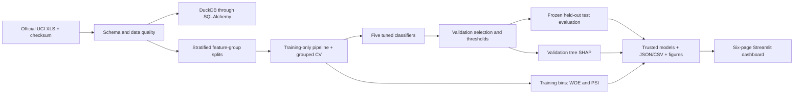
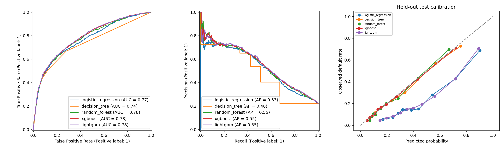
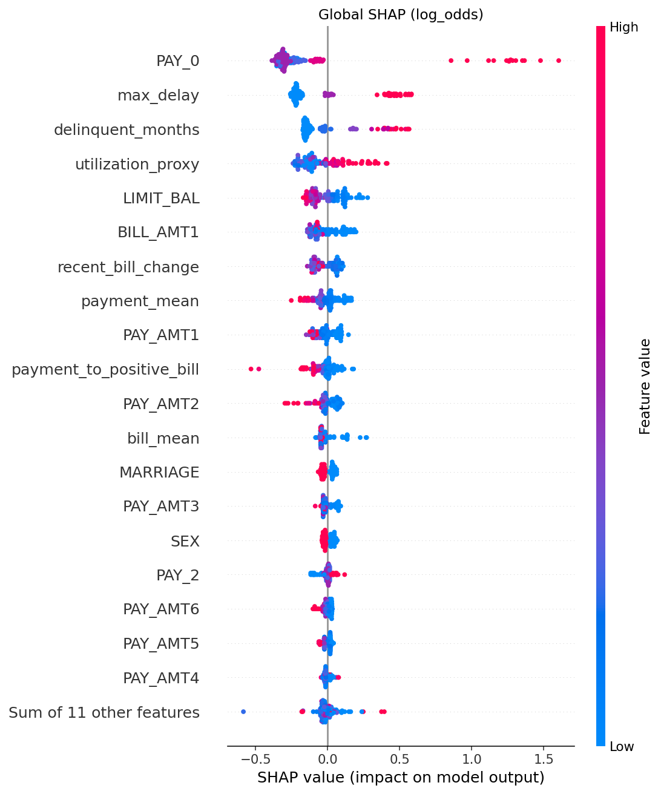

# CreditRisk-ML

A reproducible credit card payment default modeling system with SQL analytics, five classifiers, financial risk metrics, SHAP, WOE/IV, PSI, and an artifact-driven Streamlit dashboard.

**Task:** predict next-month payment default for historical credit card customers. This is an educational technical portfolio project, not a loan origination underwriting product or an empirically validated lending policy.

## Quick start

Python 3.11 is the reference runtime. Run from the repository root:

```bash
python3.11 -m venv .venv
source .venv/bin/activate
python -m pip install --upgrade pip
python -m pip install --require-hashes -r requirements.lock.txt
python -m pip install --no-deps -e .
python scripts/download_data.py
python scripts/prepare_data.py
python scripts/train_models.py --mode fast
python scripts/evaluate_models.py
streamlit run app/main.py --server.headless=true
```

`requirements.txt` pins direct dependencies; `requirements.lock.txt` includes transitive versions and distribution hashes. The lock is generated using `uv pip compile requirements.txt --python-version 3.11 --generate-hashes -o requirements.lock.txt`. On machines with a different platform, regenerate and review the lock if platform packages cannot be resolved. A simpler development install is `pip install -e .`.

Fast mode uses all 30,000 real observations, 3 CV folds and 2 search candidates per model. It does not replace training with synthetic data. Comprehensive mode uses 8 candidates and 300 trees for ensembles:

```bash
python scripts/train_models.py --mode comprehensive
python scripts/train_models.py --mode fast --config configs/default.yaml
ruff check .
ruff format --check .
pytest -q
```

Use an unused `CREDITRISK_ARTIFACT_DIR` to retain multiple independent experiments. Refreshing the same directory overwrites generated outputs and removes the old results manifest before starting. Only a successful full run writes the new manifest. Dashboard pages never train models.

## Dataset and attribution

[UCI Default of Credit Card Clients](https://archive.ics.uci.edu/dataset/350/default+of+credit+card+clients), DOI [10.24432/C55S3H](https://doi.org/10.24432/C55S3H), introduced by I-Cheng Yeh. 30,000 Taiwan credit card customers, April–September 2005 histories, 23 predictors and a next-month default label. Original amounts are NT dollars. The observed default rate is 22.12%.

Yeh, I.-C. and Lien, C.-H. (2009), *The comparisons of data mining techniques for the predictive accuracy of probability of default of credit card clients*, Expert Systems with Applications 36(2), 2473–2480, DOI 10.1016/j.eswa.2007.12.020. Dataset license: CC BY 4.0; source code license: MIT.

The downloader uses the official HTTPS archive, checks the spreadsheet's SHA-256 and verifies 30,000 rows and the exact schema. Recorded source SHA-256:

`30c6be3abd8dcfd3e6096c828bad8c2f011238620f5369220bd60cfc82700933`

If network access fails, download the XLS from the UCI page manually and place it at `data/raw/default of credit card clients.xls`. Keep the original bytes; CSV conversion will not match the checksum. Cloud environments must allow `archive.ics.uci.edu` and Python package registries. No dataset credential or database service is required. `.env.example` documents optional paths; variables must be exported in your shell (no implicit dotenv loading).

Raw data, processed CSVs, binary models and row-level outputs are ignored by Git. Generated aggregate metric JSON/CSV files are small and retained for review. `prepare_data.py` exports a canonical cleaned-column CSV without fitting any learned transformations; the model pipeline subsequently performs deterministic recoding and feature construction.

## Workflow and architecture



```text
app/main.py                 Six dashboard views through sidebar navigation
src/creditrisk/              Data, features, preprocessing, models, training,
                            evaluation, SQL, SHAP, scorecard, strategy,
                            monitoring, inference and configuration
scripts/                    Download, prepare, train and evaluate commands
sql/                        Four executable analytical query files
configs/default.yaml        Reproducible training configuration
tests/                      Deterministic unit and dashboard smoke tests
docs/                       Methodology, architecture, model card, interview guide
artifacts/metrics/           Actual saved aggregate experiment results
artifacts/models/           Trusted local Joblib pipelines (ignored)
artifacts/evaluation/       Split membership and predictions (ignored)
artifacts/figures/          EDA/evaluation/SHAP figures (ignored)
data/raw/ + data/processed/ Original XLS and canonical CSV (ignored)
.github/workflows/ci.yml     Lint, tests and dependency smoke check
Dockerfile                  Single-container Streamlit runtime
```

## Leakage prevention and modeling decisions

Approximate 70/15/15 stratified splits use seed 42. Identical original feature vectors are grouped even if their labels differ, preventing them from crossing splits. Three-fold StratifiedGroupKFold also keeps them together within training. Customer IDs and the target never enter model features. All imputers, scaling and one-hot category discovery are fitted inside CV pipelines. Validation AUC selects the tuned winner; test labels are used only after model and strategy choices are fixed. No trustworthy chronology is available for an out-of-time validation claim.

Logistic regression one-hot encodes demographic and repayment status codes and scales continuous features. Trees keep numeric codes and engineered features without scaling; this is a pragmatic ordered-code benchmark with limitations documented in [methodology](docs/methodology.md). Class weight candidates for logistic/LightGBM and scale_pos_weight candidates for XGBoost are compared within CV; no oversampling is performed. Brier score and calibration plots report probability quality separately. There is no automatic probability calibration.

Hyperparameter search optimizes ROC-AUC. Results record baseline validation performance, tuned CV scores, tuned training/validation/test performance, best parameters and feature names. A tuned model can perform worse than its baseline. Fixed tree counts avoid passing an external validation set into CV early stopping.

## Real experiment results

See [comparison.csv](artifacts/metrics/comparison.csv) and [results.json](artifacts/metrics/results.json) for the actual executed run. The table below records the verified fast-mode run. Do not assume a model is available merely because aggregate results are committed: run training to generate compatible local models and row-level artifacts.

| Model | Validation AUC | Test AUC | Test AP | Test KS | Test Brier |
|---|---:|---:|---:|---:|---:|
| logistic_regression | 0.7683 | 0.7663 | 0.5331 | 0.4277 | 0.1849 |
| decision_tree | 0.7298 | 0.7366 | 0.4815 | 0.3893 | 0.1377 |
| random_forest | 0.7779 | 0.7770 | 0.5479 | 0.4227 | 0.1351 |
| xgboost | 0.7822 | 0.7824 | 0.5534 | 0.4286 | 0.1341 |
| lightgbm | 0.7816 | 0.7841 | 0.5537 | 0.4329 | 0.1802 |

Executed fast-mode run on all 30,000 source records, seed 42. Split sizes: {'train': 20995, 'validation': 4505, 'test': 4500}. Selected **xgboost** by validation AUC, even though LightGBM's descriptive test AUC is slightly higher. No model changes were made from test scores.

Tuning did not improve every model: the decision tree validation AUC fell from 0.7587 to 0.7298. The tiny two-candidate search is a development budget, not a claim of exhaustive optimization. Balanced logistic regression and LightGBM show worse raw probability calibration; their Brier scores document that tradeoff.

Frozen strategy: approval < 0.16, review < 0.50, rejection otherwise. Test approval 56.56%, review 31.33%, rejection 12.11%; observed default among approvals 9.98%; default capture in review/rejection 74.47%. These are educational retrospective statistics.





ROC-AUC, AP, KS and Brier are threshold independent. Precision, recall, F1 and confusion matrices use 0.5. AP is average precision, not trapezoidal PR-AUC. Probability ≥ boundary belongs to the higher risk tier. Accuracy is deliberately not the primary selection metric: predicting every customer as nondefault would already achieve 77.88% accuracy on this dataset.

After training, view actual figures at `artifacts/figures/eda.png`, `correlation.png`, `target_distributions.png`, `evaluation.png`, `selected_model.png`, `feature_importance.png`, `shap_summary.png`, `shap_importance.png`, `shap_dependence.png` and `shap_waterfall.png`. They are generated locally from real observations/predictions, not placeholder screenshots.

## Dashboard and educational strategy

Six sidebar pages cover data quality/SQL/EDA, model performance, individual prediction, SHAP, strategy and monitoring. Inputs match all 23 source predictors. Global SHAP uses 150 validation customers; local explanations reconstruct the model output and label probability versus log-odds scale. If logistic regression wins overall, SHAP uses the separate best validation tree and explicitly names it; individual logistic explanations show coefficient contributions.

The validation strategy searches approval boundaries to maximize accepted fraction under an illustrative observed default-rate constraint of 10%; review-to-reject is fixed at 0.50 by default. No feasibility guarantee is implied. Slider exploration only recalculates validation statistics. Test strategy is frozen. These historical-label simulations do not identify the consequences of approving or denying credit and do not estimate profit or expected credit loss.

PSI uses training reference quantile bins, an explicit missing bin and half-count smoothing. Default monitoring compares training against validation, not production. A checkbox demonstrates an explicitly synthetic +50% credit-limit shift. 0.10/0.25 flags are contextual heuristics.

## Docker

First run training locally, then mount your trusted artifact directory:

```bash
docker build -t creditrisk-ml .
docker run --rm -p 8501:8501 \
  -v "$PWD/artifacts:/app/artifacts:ro" \
  -v "$PWD/data:/app/data:ro" creditrisk-ml
```

Do not load downloaded or user-uploaded Joblib files. Joblib can execute arbitrary Python code. Docker build validation and comprehensive training status are recorded in the verification section; this repository implements CI checks, not continuous deployment.

## Verification

Verified in the cloud workspace with Python 3.11.17:

| Check | Outcome |
|---|---|
| Direct + transitive hash-locked dependencies | Installed and repeatably verified |
| Official UCI download and schema/checksum | Passed; 30,000 rows, 25 original columns |
| Data preparation and SQL/Pandas equivalence | Passed |
| Five baselines and grouped-CV tuned models | Executed on the real dataset |
| Frozen test metric recomputation | Passed for all five models |
| Ruff lint and formatting | Passed |
| Pytest | **28 passed**, 0 failed, 0 skipped |
| Populated dashboard AppTest | Six views, inference, local SHAP, strategy isolation and PSI passed |
| Running Streamlit health + application shell | HTTP 200 and expected responses |
| Reusable setup script | Executed successfully using retained validated artifacts |
| Docker image | Built; container health, all dashboard checks and metric recomputation passed |
| Comprehensive training | Available, not executed |
| GitHub-hosted Actions run | Workflow created; not triggered from this local checkout |

To repeat the populated dashboard integration check: `python scripts/smoke_app.py`. It requires a completed real-data run. No checks were skipped to hide an unresolved failure.

The cloud Docker build required the platform proxy to be resolvable inside the build network and the trusted host CA bundle to be supplied as a BuildKit mount. On hosts behind an HTTPS proxy, use supported proxy build arguments and an authorized CA bundle:

```bash
docker build --build-arg HTTP_PROXY --build-arg HTTPS_PROXY --build-arg NO_PROXY \
  --secret id=build_ca,src=/path/to/trusted-ca-bundle.pem \
  -t creditrisk-ml .
```

The CA mount is optional for ordinary public-trust builds, used only during package installation and not baked into the image. Package hashes and TLS verification stay enabled. In this cloud workspace, the proxy hostname also needed an `--add-host` mapping to its resolved platform address. This is environment networking configuration, not an application dependency. The default `docker build` example is for a host with working standard networking.


CI installs Python 3.11, runs Ruff and Pytest, and checks model construction. Unit tests use small deterministic synthetic fixtures solely for testing; CI does not download the dataset or train full experiments. Full-data training and populated-dashboard validation are separate local integration checks.

## Limitations and next improvements

A single 2005 Taiwan portfolio cannot establish current-market or geographic generalization. Customer sampling, credit limits, policy and survivorship effects constrain inference. Sex, age, education and marital status carry fairness concerns; this project provides no fairness certification. Treat association-based feature importance, WOE/IV and SHAP as descriptive. Six months of bills/payments are not transaction-level histories. Calibration can deteriorate under shift.

Next steps: assess subgroup error/calibration with uncertainty intervals; compare training-only calibrated candidates; test external and genuinely chronological datasets; add schema/versioned model registry, audit logging and delayed-label monitoring for a production design. Distributed Spark/Hive processing would be warranted only at substantially greater volume. See [model card](docs/model_card.md), [architecture](docs/architecture.md), [methodology](docs/methodology.md) and [25-question interview guide](docs/interview_guide.md).
