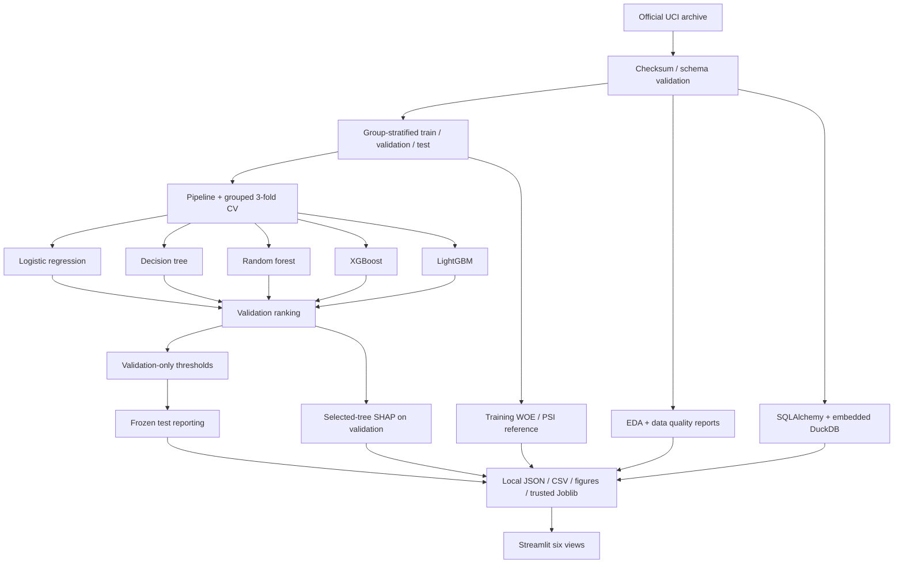

# Architecture

`config.py` resolves data/artifact roots from environment variables; relative paths use the launch working directory, so documented commands run in the repo root. `data_loader.py` is the source/schema boundary; `feature_engineering.py` contains stateless historical calculations. `preprocessing.py` puts learned imputation, category discovery and scaling inside estimator pipelines. `models.py` constructs candidates and modest search spaces. `training.py` orchestrates the experiment and only writes the main manifest after all outputs, including SHAP, succeed. Failure while refreshing removes the main manifest so dashboard loading does not mix an old run with partially refreshed output. Use distinct artifact roots to retain experiments; concurrent writers to one root are unsupported.

SQL uses a disposable in-memory database: no server, credentials or migrations. Scorecard analysis is separate from the predictive pipelines. Monitoring does not simulate production arrival implicitly. `inference.py` enforces the original 23-field schema and restricts artifact loading to explicit trust; this is a caller trust boundary, not a sandbox. The dashboard only chooses hard-coded local artifact names, never user-supplied pickle paths.

Artifacts retain preprocessing with the model. Split CSVs carry actual IDs/labels/features to audit membership; prediction CSVs carry actual class-1 probabilities. Metrics include baselines, tuned train/validation/test metrics, parameters, versions, digest, configuration, model choice and thresholds. CV detail CSVs record every evaluated candidate. The lightweight evaluation command recomputes saved test metrics without fitting models or retuning decisions.

The UI caches reads keyed by path and file modification time and caches locally trusted pipelines. It does not execute training on page visits. Sidebar navigation implements the requested six pages in one file to avoid duplicated loading logic. Missing artifacts produce a clear preparation command; malformed/incomplete experiments produce a friendly message with details in the server log. No database/network calls are made during prediction.

CI covers deterministic fixture tests without full-data downloads. Docker is a single Python/Streamlit container with libgomp for LightGBM. Models and data are mounted read-only after local preparation. It is a packaging option, not an implemented deployment service. A real production extension would separate batch training from inference, introduce a signed/versioned artifact registry, authentication, validation and audit events, monitoring jobs and delayed-label evaluation. Distributed processing is unnecessary for 30,000 rows.
